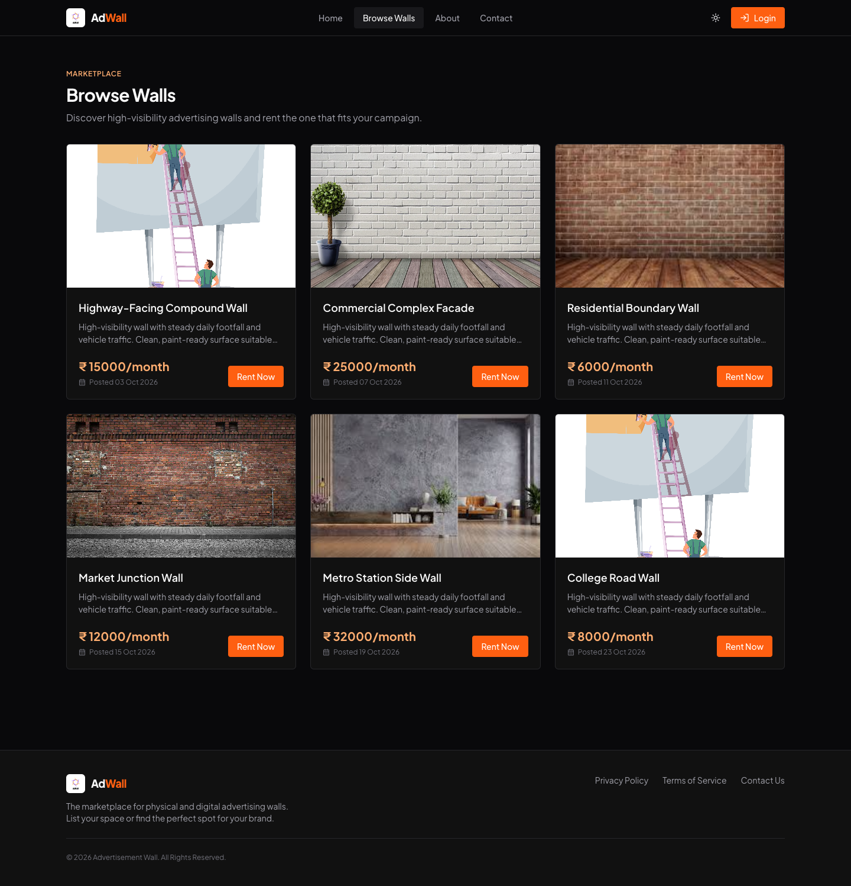
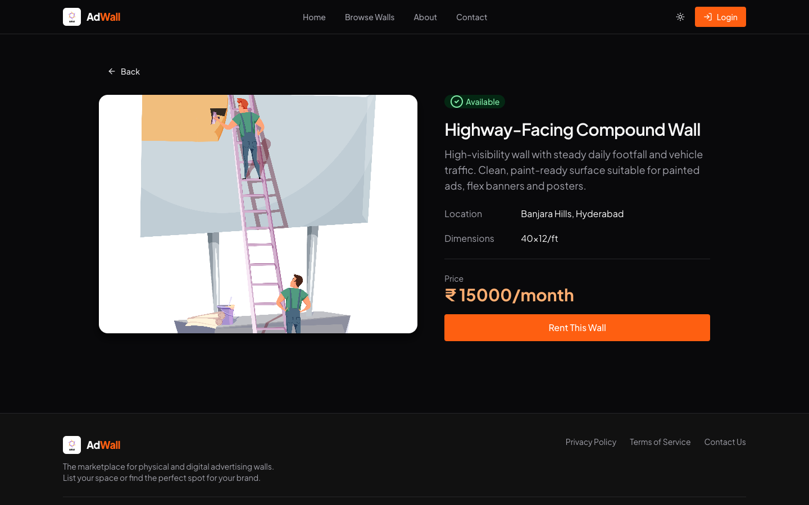
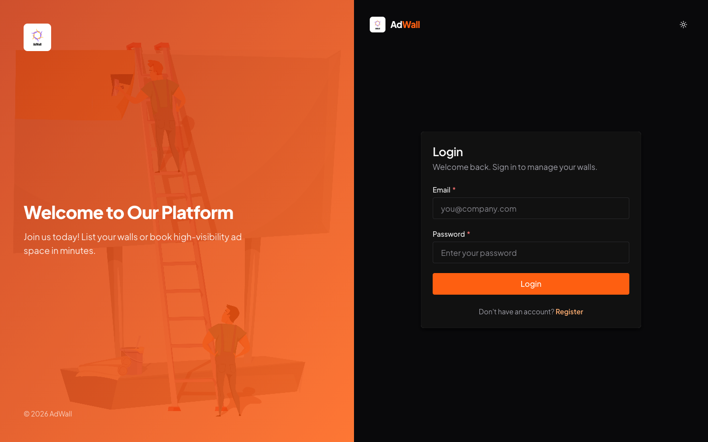
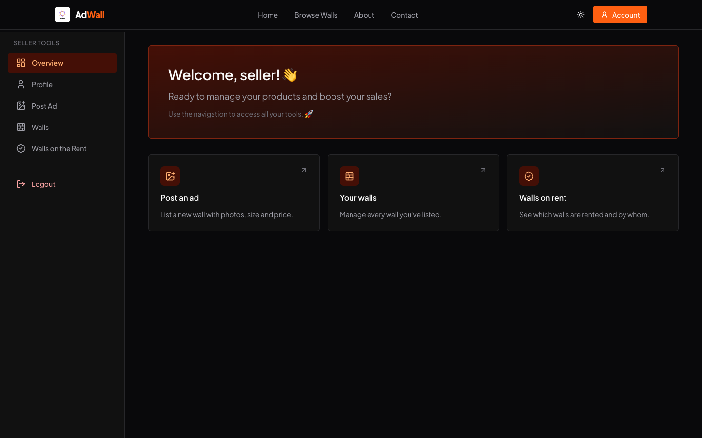
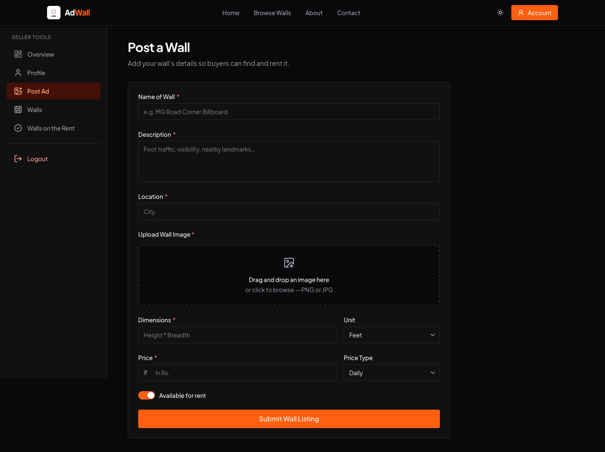
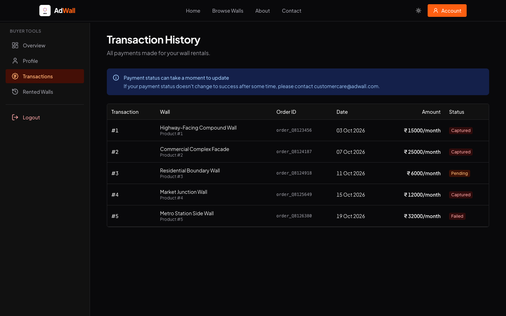
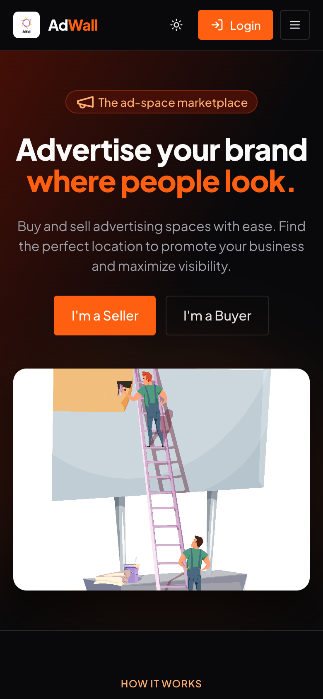
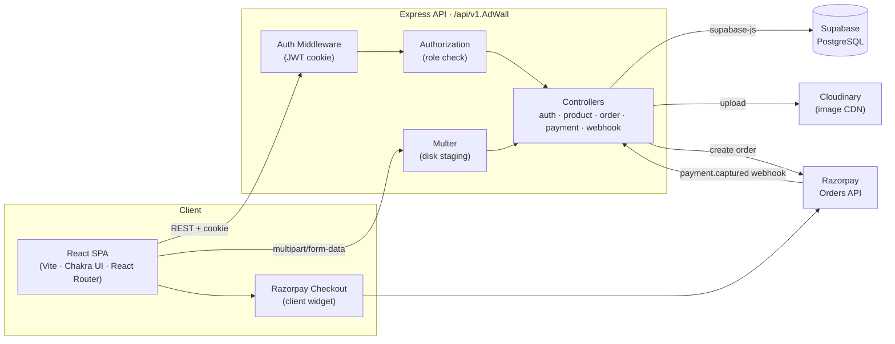
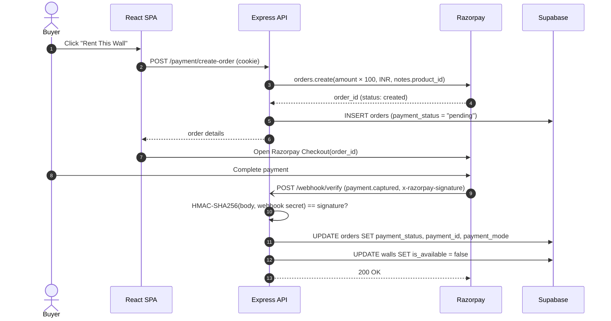
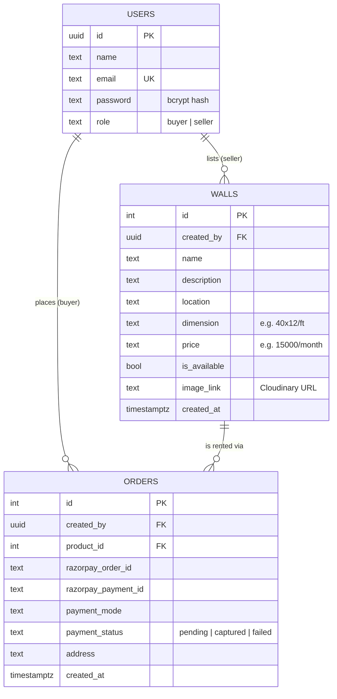

<div align="center">


# AdWall

**A two-sided marketplace for renting physical advertising space.**

Property owners list idle compound walls, building facades and billboards; advertisers discover, compare and rent them with integrated online payments.


</div>

---

## Table of Contents

- [Overview](#overview)
- [Screenshots](#screenshots)
- [Key Features](#key-features)
- [System Architecture](#system-architecture)
- [Technology Stack](#technology-stack)
- [Payment Workflow](#payment-workflow)
- [Data Model](#data-model)
- [API Reference](#api-reference)
- [Repository Structure](#repository-structure)
- [Getting Started](#getting-started)
- [Configuration Notes](#configuration-notes)
- [Author](#author)

---

## Overview

Outdoor advertising inventory is fragmented: many high-visibility walls sit unused because owners have no simple way to reach advertisers, and advertisers have no single place to find and book them. **AdWall** closes that gap with a role-based web platform:

| Role | Goal on the platform |
| --- | --- |
| **Seller** (wall owner) | List a wall with photos, location, dimensions and pricing; track which walls are currently rented. |
| **Buyer** (advertiser) | Browse available walls, review details, pay online through Razorpay and manage rentals and transactions. |

The repository is a **monorepo** with two independently deployable applications:

- [`frontend/`](frontend/) – React single-page application built with Vite and Chakra UI v3.
- [`backend/`](backend/) – Node.js / Express REST API backed by Supabase (PostgreSQL), Cloudinary and Razorpay.

---

## Screenshots

> Screenshots were captured from the running application, with sample wall listings loaded.

### Landing Page


### Marketplace and Wall Details
| Browse Walls | Wall Details |
| :---: | :---: |
|  |  |

### Authentication


### Seller Workspace
| Seller Dashboard | Post a Wall |
| :---: | :---: |
|  |  |

### Buyer Workspace and Mobile View
| Transaction History | Mobile (390 px) |
| :---: | :---: |
|  |  |

---

## Key Features

### Marketplace
- Public catalogue of available walls with server-side pagination.
- Detail pages showing location, dimensions, pricing model (daily / weekly / monthly) and live availability.
- Walls are automatically marked **unavailable** once a rental payment is captured.

### Seller Capabilities
- Multipart wall-listing form with image upload (Multer → Cloudinary CDN).
- Portfolio view of all listed walls, with per-wall availability status.
- "Walls on Rent" view of currently rented inventory, with per-wall detail pages.

### Buyer Capabilities
- Guarded checkout flow (authentication required).
- Razorpay Checkout integration supporting cards, UPI, net banking and wallets.
- Transaction history with Razorpay order IDs and status (`pending`, `captured`, `failed`).
- "Rented Walls" view of all successfully paid rentals.

### Platform
- **JWT authentication** delivered through an `httpOnly`, `secure`, `SameSite=None` cookie (24-hour expiry).
- **Role-based access control** via a dedicated authorization middleware (`buyer` / `seller`).
- Passwords hashed with **bcrypt** (10 salt rounds).
- **Webhook-driven payment confirmation** with HMAC-SHA256 signature verification.
- Responsive UI with light/dark color modes and a custom Chakra UI design system ([`frontend/src/theme.js`](frontend/src/theme.js)).
- Route-level code splitting with `React.lazy` and `Suspense`.

---

## System Architecture



**Request lifecycle.** Each protected request carries the `ad_wall` cookie. `auth.middleware.js` verifies the JWT and attaches the decoded user (`id`, `email`, `role`) to `req.user`. Where required, `autho.middleware.js` then enforces the allowed roles before the controller runs. Controllers talk to Supabase through a shared client ([`backend/src/database/db.connect.js`](backend/src/database/db.connect.js)).

---

## Technology Stack

| Layer | Technology | Purpose |
| --- | --- | --- |
| UI framework | React 18, React Router 7 | SPA rendering and client-side routing |
| Build tooling | Vite 6 (SWC) | Dev server, HMR, production bundling |
| Design system | Chakra UI v3, Emotion, next-themes | Component library, theme tokens, color modes |
| Icons / UX | lucide-react, react-hot-toast, moment | Iconography, notifications, date formatting |
| API server | Node.js, Express 4 | REST API and middleware pipeline |
| Database | Supabase (PostgreSQL) | Persistent storage for users, walls and orders |
| Auth | jsonwebtoken, bcryptjs, cookie-parser | Token issuance, password hashing, cookie handling |
| Media | Multer, Cloudinary | Upload staging and CDN-hosted images |
| Payments | Razorpay (Orders API, Checkout, Webhooks) | Order creation, payment capture, verification |
| Hosting | Vercel (frontend, SPA rewrite in [`vercel.json`](frontend/vercel.json)) | Static hosting |

---

## Payment Workflow

Payment state is never trusted from the client. The order is created server-side, and only a signature-verified Razorpay webhook can mark it as paid.



---

## Data Model



> The schema above is derived from the queries in [`backend/src/controllers/`](backend/src/controllers/). Column types are indicative; match them to your Supabase project.

---

## API Reference

Base URL: `http://localhost:8080/api/v1.AdWall`

🔒 = requires the `ad_wall` auth cookie · 🏷️ = role-restricted

| Method | Endpoint | Access | Description |
| --- | --- | --- | --- |
| `POST` | `/auth/register` | Public | Register a user (`name`, `email`, `password`, `role`). |
| `POST` | `/auth/login` | Public | Authenticate and set the `ad_wall` JWT cookie. |
| `GET` | `/product/list?page=&limit=` | Public | Paginated list of available walls. |
| `GET` | `/product/single?product_id=` | Public | Details of a single wall. |
| `POST` | `/product/add` | 🔒 🏷️ seller | Create a wall listing (`multipart/form-data`, field `image`). |
| `GET` | `/product/seller/walls?page=&limit=` | 🔒 | Walls listed by the current seller. |
| `GET` | `/product/seller/rented?page=&limit=` | 🔒 | The seller's walls that are currently rented. |
| `GET` | `/product/rent-single?product_id=` | 🔒 | Rented wall details, joined with the listing owner's name and email. |
| `GET` | `/product/buyer/rented?page=&limit=` | 🔒 | Walls the current buyer has successfully rented. |
| `GET` | `/order/list?page=&limit=` | 🔒 | The buyer's transaction history. |
| `POST` | `/payment/create-order` | 🔒 | Create a Razorpay order and a `pending` order record. |
| `POST` | `/payment/place-order` | 🔒 | Acknowledge order placement from the client. |
| `POST` | `/webhook/verify` | Razorpay | Signature-verified `payment.captured` handler. |

All responses follow a consistent envelope:

```json
{ "success": true, "data": [ ... ], "totalCount": 42 }
{ "success": false, "message": "Human-readable error" }
```

---

## Repository Structure

```
adwall/
├── backend/
│   └── src/
│       ├── index.js              # Express bootstrap, CORS, route mounting
│       ├── controllers/          # auth, product, orders, razorpay, webhook
│       ├── routes/               # Express routers per domain
│       ├── middleware/           # JWT authentication, role authorization
│       ├── helpers/              # Razorpay client, Multer storage
│       └── database/             # Supabase client
├── frontend/
│   ├── public/images/            # Logo and static imagery
│   └── src/
│       ├── App.jsx               # Route table (lazy-loaded pages)
│       ├── theme.js              # Chakra UI design system
│       ├── layouts/              # Public and dashboard layouts
│       ├── pages/                # auth, buyer, seller, marketing pages
│       ├── products/             # Marketplace, details, checkout, success
│       ├── components/           # Header, footer, shared UI components
│       ├── context/ · hooks/     # Auth context and hooks
│       └── routes/               # PrivateRoute guard
└── docs/screenshots/             # Images used in this README
```

---

## Getting Started

### Prerequisites

- Node.js **18+** and npm
- A **Supabase** project with `users`, `walls` and `orders` tables (see [Data Model](#data-model))
- A **Cloudinary** account
- A **Razorpay** account (test mode is sufficient), plus a tunnel such as **ngrok** to receive webhooks locally

### 1. Clone

```bash
git clone https://github.com/sbn-raju/AdWall-Epam.git
cd AdWall-Epam
```

### 2. Backend

```bash
cd backend
npm install
```

Create `backend/.env`:

```dotenv
PORT=8080

# Supabase
SUPABASE_URI=https://<project>.supabase.co
SUPABASE_ANON_KEY=<anon-key>

# Auth
JWT_TOKEN_KEY=<long-random-secret>

# Cloudinary
CLOUDINARY_CLOUD_NAME=<cloud-name>
CLOUDINARY_CLOUD_KEY_ID=<api-key>
CLOUDINARY_CLOUD_KEY_SECRET=<api-secret>

# Razorpay
RAZOR_KEY_ID=<key-id>
RAZOR_KEY_SECRET=<key-secret>
RAZOR_KEY_WEBHOOK=<webhook-secret>
```

```bash
npm run dev        # nodemon, development
npm run build      # transpile src/ → dist/ with Babel
npm start          # run the compiled build
```

### 3. Frontend

```bash
cd frontend
npm install
```

Create `frontend/.env`:

```dotenv
VITE_REACT_RAZORPAY_ID=<razorpay-key-id>
```

```bash
npm run dev        # http://localhost:5173
npm run build      # production bundle in dist/
npm run preview    # serve the production bundle locally
```

### 4. Razorpay Webhook (local)

```bash
ngrok http 8080
```

In the Razorpay dashboard, register `https://<ngrok-id>.ngrok-free.app/api/v1.AdWall/webhook/verify` for the `payment.captured` event, using the same secret as `RAZOR_KEY_WEBHOOK`.

---

## Configuration Notes

- **API base URL**: the frontend reads it from [`frontend/src/utils/base_uri.js`](frontend/src/utils/base_uri.js) (default `http://localhost:8080/api/v1.AdWall`). Update it for each deployment environment.
- **CORS**: allowed origins are declared in [`backend/src/index.js`](backend/src/index.js). Add your deployed frontend origin there.
- **Cookies**: the auth cookie is issued with `secure: true` and `SameSite=None`, so cross-origin deployments must be served over HTTPS.
- **Secrets**: `.env` files are git-ignored. Never commit Supabase, Cloudinary or Razorpay credentials.

---

## Author

**SBN Raju** · [GitHub @sbn-raju](https://github.com/sbn-raju)

<div align="center">
<sub>Turning ordinary walls into high-visibility media inventory.</sub>
</div>
