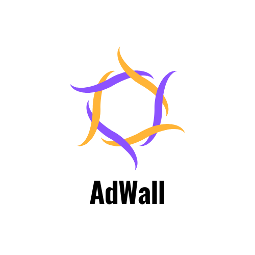

<div align="center">



# AdWall · Backend

Express REST API for the AdWall advertising-space marketplace.

</div>

> For the full system overview, screenshots, data model and payment sequence diagram, see the [root README](../README.md).

## Overview

The API handles authentication, wall listings, rental orders and payment verification. It is a stateless Express service that:

- issues **JWTs** in an `httpOnly` cookie (`ad_wall`) and enforces **role-based access** (`buyer` / `seller`);
- persists users, walls and orders in **Supabase (PostgreSQL)**;
- stages uploads with **Multer** and hosts images on **Cloudinary**;
- creates **Razorpay** orders and confirms payments through an **HMAC-SHA256-verified webhook**.

## Tech Stack

| Concern | Library |
| --- | --- |
| HTTP server | Express 4, `cors`, `cookie-parser` |
| Database | `@supabase/supabase-js` |
| Auth | `jsonwebtoken`, `bcryptjs` |
| Uploads and media | `multer`, `cloudinary` |
| Payments | `razorpay`, Node `crypto` (webhook signatures) |
| Build | Babel (`@babel/preset-env`) → `dist/` |

## Project Structure

```
src/
├── index.js                     # App bootstrap, CORS, route mounting
├── routes/                      # auth, product, order, razorpay, webhook routers
├── controllers/                 # Request handlers and Supabase queries
├── middleware/
│   ├── auth.middleware.js       # Verifies JWT from the ad_wall cookie → req.user
│   └── autho.middleware.js      # authorization(["seller"]) role guard
├── helpers/
│   ├── RazorPay.js              # Razorpay SDK client
│   └── multer.js                # Disk storage for uploads
└── database/db.connect.js       # Supabase client
```

## API Endpoints

Base path: `/api/v1.AdWall`

| Method | Endpoint | Auth | Description |
| --- | --- | --- | --- |
| `POST` | `/auth/register` | – | Register a buyer or seller |
| `POST` | `/auth/login` | – | Log in and set the auth cookie |
| `GET` | `/product/list` | – | Paginated available walls |
| `GET` | `/product/single` | – | Single wall by `product_id` |
| `POST` | `/product/add` | Seller | Create a listing (multipart, field `image`) |
| `GET` | `/product/seller/walls` | User | Seller's listings |
| `GET` | `/product/seller/rented` | User | Seller's rented walls |
| `GET` | `/product/rent-single` | User | Rented wall details |
| `GET` | `/product/buyer/rented` | User | Buyer's paid rentals |
| `GET` | `/order/list` | User | Buyer's transaction history |
| `POST` | `/payment/create-order` | User | Create a Razorpay order and a pending order row |
| `POST` | `/payment/place-order` | User | Client-side order acknowledgement |
| `POST` | `/webhook/verify` | Razorpay signature | Handle `payment.captured` and mark the wall rented |

List endpoints accept `page` and `limit` query parameters (default `1` and `10`).

## Getting Started

```bash
npm install
# create .env with the variables listed below
npm run dev
```

### Environment Variables

| Variable | Description |
| --- | --- |
| `PORT` | HTTP port (the frontend expects `8080`) |
| `SUPABASE_URI` / `SUPABASE_ANON_KEY` | Supabase project URL and key |
| `JWT_TOKEN_KEY` | Secret used to sign JWTs |
| `CLOUDINARY_CLOUD_NAME` / `CLOUDINARY_CLOUD_KEY_ID` / `CLOUDINARY_CLOUD_KEY_SECRET` | Cloudinary credentials |
| `RAZOR_KEY_ID` / `RAZOR_KEY_SECRET` | Razorpay API keys |
| `RAZOR_KEY_WEBHOOK` | Razorpay webhook secret, used for signature verification |

### Scripts

| Script | Description |
| --- | --- |
| `npm run dev` | Start with `nodemon` from `src/` |
| `npm run build` | Transpile `src/` to `dist/` with Babel |
| `npm start` | Run the compiled `dist/index.js` |

### Webhooks in Local Development

Expose the server with `ngrok http 8080`, then register `https://<id>.ngrok-free.app/api/v1.AdWall/webhook/verify` in the Razorpay dashboard for the `payment.captured` event.
