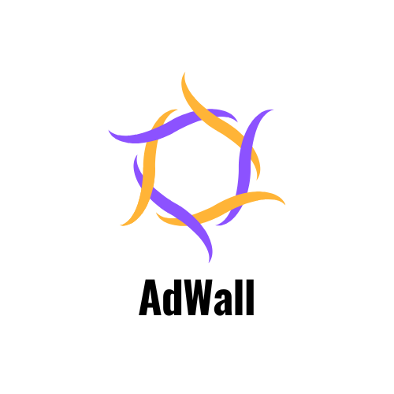

<div align="center">



# AdWall · Frontend

React single-page application for the AdWall advertising-space marketplace.

</div>


> For the full system overview, architecture, payment workflow and API reference, see the [root README](../README.md).

## Overview

The frontend serves two audiences from one codebase:

- **Public marketplace**: landing page, wall catalogue, wall detail pages and authentication.
- **Role-based dashboards**: a **seller** workspace (post walls, manage listings, track rented walls) and a **buyer** workspace (rented walls, transaction history), rendered inside a shared `DashboardLayout`.

## Tech Stack

| Concern | Library |
| --- | --- |
| Rendering and routing | React 18, React Router 7 (lazy-loaded routes with `Suspense`) |
| Build | Vite 6 with `@vitejs/plugin-react-swc` |
| UI system | Chakra UI v3, Emotion, `next-themes` for light/dark mode |
| Icons and feedback | `lucide-react`, `react-hot-toast` |
| Dates | `moment` |
| Payments | Razorpay Checkout (`window.Razorpay`) |

## Project Structure

```
src/
├── App.jsx            # Route table
├── main.jsx           # Providers (Chakra, Auth) and root render
├── theme.js           # Design tokens: brand palette, typography, semantic colors
├── layouts/           # Layout (public) and DashboardLayout (sidebar workspace)
├── pages/
│   ├── auth/          # Login, Register, AuthShell
│   ├── seller/        # Dashboard, WallForm, AdsWall, Product, rent/*
│   └── buyer/         # Dashboard, RentedWalls
├── products/          # ProductsList, ProductDetails, CheckoutPage, PaymentSuccess
├── components/
│   ├── common/        # WallCard, WallGrid, PaginationBar, AvailabilityBadge, ...
│   └── ui/            # Chakra provider and color-mode helpers
├── context/ · hooks/  # AuthContext and useAuth
├── routes/            # PrivateRoute guard
└── utils/base_uri.js  # API base URL
```

## Routes

| Path | Access | Screen |
| --- | --- | --- |
| `/home`, `/about-us` | Public | Marketing pages |
| `/products-list` | Public | Wall catalogue |
| `/product/:product_id` | Public | Wall details |
| `/login`, `/register` | Public | Authentication |
| `/checkout/:id` | Authenticated | Checkout (guarded by `PrivateRoute`) |
| `/payment/:product_id`, `/payment/success` | Authenticated | Razorpay payment and confirmation |
| `/seller/dashboard/*` | Seller | Overview, post a wall, walls, rented walls |
| `/buyer/dashboard/*` | Buyer | Overview, rented walls, transactions |

## Getting Started

```bash
npm install
echo "VITE_REACT_RAZORPAY_ID=<razorpay-key-id>" > .env
npm run dev        # http://localhost:5173
```

| Script | Description |
| --- | --- |
| `npm run dev` | Start the Vite dev server with HMR |
| `npm run build` | Create a production bundle in `dist/` |
| `npm run preview` | Serve the production bundle locally |
| `npm run lint` | Run ESLint |

The API base URL is configured in [`src/utils/base_uri.js`](src/utils/base_uri.js) (default `http://localhost:8080/api/v1.AdWall`).

## Deployment

The app is configured for **Vercel**. [`vercel.json`](vercel.json) rewrites all paths to `index.html` so client-side routes resolve on refresh.
